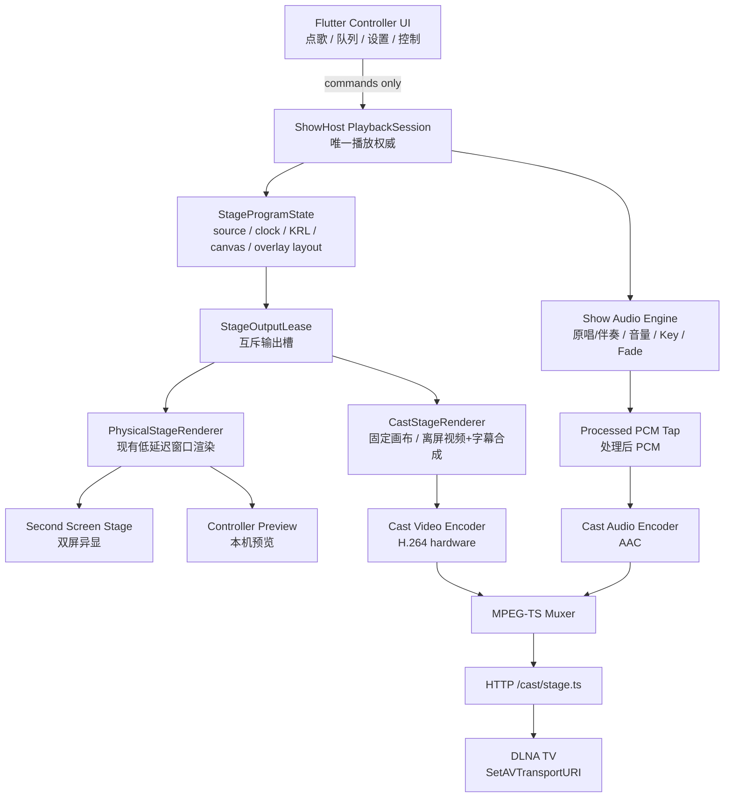
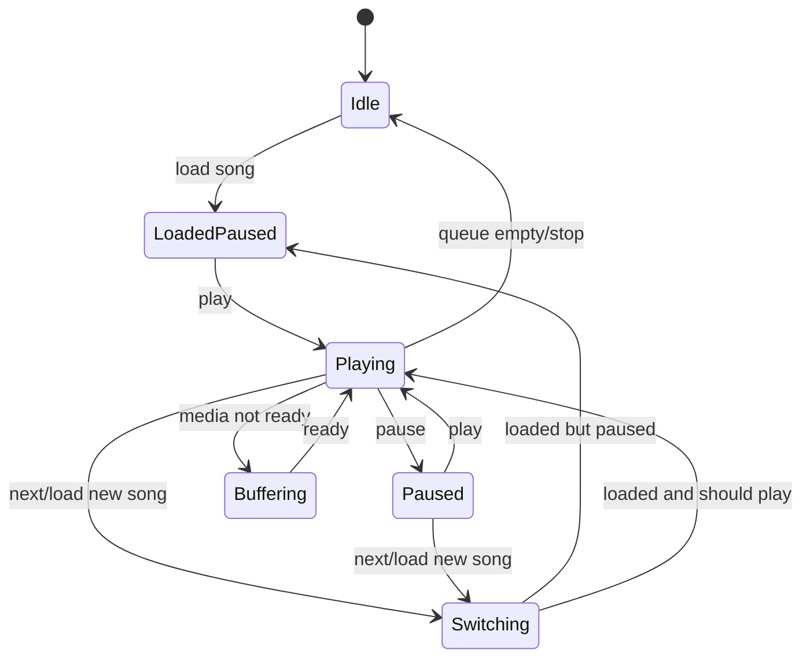

# Cast Stage Stream

Kirakara 的投屏输出是一条独立的 Stage Program Feed。它不是 Flutter
Controller UI 的镜像，也不是从预览窗口或第二屏窗口捕获画面。它更接近
内置的 KTV 专用 OBS：所有 source 都由 Kirakara Show / ShowHost 主动提供，
然后合成、编码、推流。

本文同时描述当前 Windows 实现和后续跨平台边界。当前 ShowHost 已经是
播放状态权威，Cast 路径已经拥有固定 1920x1080 画布的主动离屏合成、
H.264/AAC 编码和 MPEG-TS 输出；物理双屏仍保留低延迟窗口渲染路径。
QR 与滚动报幕 overlay 暂缓，等待与物理双屏统一设计。

DLNA / Cast 开启时，Controller Screen 不显示 Stage 预览。TS 投流和双屏异显
必须互斥：`physicalDisplay` 模式占用物理第二屏，`tsStream` 模式占用编码直播流。
二者抢同一个 Stage 输出槽，不能同时开启。

TS 投流要复用的是双屏异显背后的 Stage 节目模型、播放状态、画布和 overlay
语义，而不是录第二屏窗口。允许在更底层分成两套渲染流程：物理双屏保留
现有低延迟窗口渲染，TS 使用适合固定画布、离屏合成和编码的 Cast 渲染流程。
如果 Cast 通过第二屏 HWND / 字幕 HWND / 隐藏窗口取帧，就会把窗口层级、DPI、
字幕 viewport 和坐标系问题带进 TS 流。

## Architecture



## Playback Authority

ShowHost PlaybackSession 是唯一播放权威。DLNA / Cast 只是一种输出端，
不能维护第二套播放状态。

CastBackend 必须跟随 ShowHost 的状态：

- load / next：切换当前媒体源。
- play：开始推进时间轴。
- pause：停止推进时间轴，重复暂停帧或输出静止帧。
- seek：跳到 ShowHost 指定位置。
- buffering：输出等待帧或重复最后一帧，不能让音视频继续漂移。

ShowHost 当前已经集中持有播放状态、位置、暂停位置、音轨和视频主时钟等
状态。Cast 侧需要补的是可读取/可订阅的边界，例如 current media source
和 playback revision / callback，而不是另建一套播放器。

## State Machine



## Media Foundation Boundary

Media Foundation 可以用于 native 媒体管线：

- video decode：Source Reader / decoder MFT / D3D11 texture。
- video encode：H.264 encoder MFT / hardware encoder。
- audio encode：AAC encoder MFT。
- D3D11 device / DXGI texture flow.

Media Foundation 只负责解复用、解码和编码：decoder 直接产出 D3D11 texture，
encoder 直接消费 CastStageRenderer 的 texture。Stage 节目帧由 renderer 主动
合成。MF 不应该用于从窗口、预览框或已经渲染的 surface 取帧。
`TransferVideoFrame`、同步 `frame_at`、CPU BGRA readback 都属于已经验证过的
错误路线：它们会把已显示的东西再抠回来，容易阻塞，也会绕开真正的 Stage
输出架构。

解码端也不采用“每个 Stage 输出时刻向 MF 请求一帧”的 pull/frame-at 模型。
PlaybackSession 只同步 source、play/pause、timeline revision 和 seek 位置；MF
解码线程顺序产出一个小型 D3D11 texture 队列，CastStageRenderer 按权威 Stage
时钟消费队列中的现成纹理。编码端直接接收 CastStageRenderer 的合成纹理，MF
没有任何捕获 Stage、抓窗口或把合成结果读回 CPU 的接口。

Windows native backend 不能绑定开发机厂商。它按当前 Stage D3D adapter 动态
枚举兼容的硬件 H.264 MFT；NVIDIA、Intel Quick Sync、AMD、Qualcomm 等都只是
可能的实现。1920x1080@60 是最高输出 profile，能力不足时可协商 1080p30 等
保守 profile。若当前设备不存在兼容的 GPU converter / hardware encoder，UI
明确标记 Cast 不可用；禁止静默退回窗口捕获、CPU 像素回读或 ffmpeg。
MF/D3D11 只存在于 Windows backend，不能泄漏进跨平台 CastService 和
StageProgramState；Android 后端后续独立实现。

Cast 按电视直播处理，不能把歌曲时间轴当成编码时间轴。Stage content clock
允许暂停、seek、倒退和切歌；Cast transport clock 从开启投流到停止投流只允许
单调前进。暂停时持续编码同一张合成帧，seek/重唱只改变后续节目纹理内容，不能
重置 H.264/AAC/MPEG-TS 的 PTS。这里消费的是 Stage 合成后的 GPU texture，
不是捕获 StageWindow、桌面或 Flutter HWND。

## Current Show Pipelines

当前物理双屏的低延迟显示管线仍然是窗口层叠：

```text
MF Media Engine -> stage HWND / swap chain
LyricRenderer   -> independent WS_EX_LAYERED subtitle window
```

视频和字幕在物理双屏上仍靠窗口 Z-order 组合。Cast 不读取这些 HWND；它通过
`StageOutputLease.tsStream` 互斥抢占输出槽，并使用独立的主动离屏管线：

```text
MF decoder texture + KRL overlay texture -> composed 1920x1080 stage texture
                                            -> H.264 + AAC -> MPEG-TS
```

CastStageRenderer 维护固定 1920x1080 节目画布。源视频无论是 720p、1080p、
4K、24fps、30fps 还是 60fps，都只是这个画布里的一个 source：按规则
letterbox / scale 后放入画布，再叠加字幕；QR 和报幕后续按统一 Stage overlay
设计接入。Encoder 只看到固定规格的 composed stage texture，不直接感知
源视频分辨率或帧率变化。

当前 Cast 路线用 MF media source / decoder MFT 直接输出 D3D11 texture，再把
KRL 渲染到透明 overlay texture，最后合成。这里的 texture 是 decoder output，
不是从 HWND、swap chain 或已经显示的画面抓回来的帧。

物理双屏保留现有窗口输出作为 `physicalDisplay` renderer，同时为 TS 建立
`tsStream` Cast renderer。二者必须互斥。Cast renderer 可以独立解码当前视频，
但它必须完全受 ShowHost PlaybackSession 控制，不能自己推进时间轴。共享的是
StageProgramState、画布、歌词和 overlay 语义，不要求两个 renderer 共用同一张
GPU texture。

## Cast Video

Cast video 必须来自 ShowHost 主动合成的 Stage 画面：

1. 读取当前歌曲背景视频。
2. 按 16:9 Stage 输出 letterbox / scale。
3. 叠加 KRL 歌词；QR、报幕和指示层等后续按统一 Stage overlay 接入。
4. 输出给 H.264 encoder。

启动 Cast video 前，App 必须确认没有物理第二屏或调试 StageWindow 正在占用
Stage 输出槽；如果已经占用，TS 开关禁用或要求用户先关闭该输出。

未播放时不能推进视频。暂停时不能推进视频。切歌时优先保持 HTTP / DLNA URL
稳定，可以重复最后一帧或输出 idle frame，等新源 ready 后继续输出 SPS/PPS
和 IDR。因为 Cast 输出是固定画布，切歌不应该改变 encoder 的输出分辨率、
帧率或基础流规格。真实电视兼容性不佳时，允许重建内部 encoder/session，
但外部 URL 应尽量稳定，并把这种行为记录为设备兼容策略，而不是默认架构。

## Cast Audio

Cast audio 必须来自 Show 音频处理链之后的 PCM。它必须已经应用：

- 原唱 / 伴奏切换。
- volume。
- key shift。
- key fade。

CastBackend 不能重新读取 vocal / inst 文件，也不能偷用背景视频自带音轨。
否则 DLNA 听到的声音会和房间实际播放不一致。

## Runtime Encoder Policy

Cast 的正式运行路径已经改为全原生链路：ShowHost 主动合成 D3D11 Stage
texture，优先由兼容当前 D3D adapter 的硬件 H.264 MFT 直接消费。启动顺序为
1080p60 hardware、1080p30 hardware、1080p30 software。软件兜底仍在 GPU
完成 BGRA 到 NV12，只把最终 NV12 帧回读给 Windows 系统 H.264 MFT；队列
来不及处理时丢弃 Cast 输出帧，不允许累积直播延迟。当前时间线成功提交首帧
后，偶发视频丢帧只保持上一画面，不能打断连续音频；切歌后则重新等待新视频
时间线首帧，防止音频抢跑。App 处理后的 PCM 由系统 AAC-LC MFT 编码，再与
视频复用为 MPEG-TS。

App 和 ShowHost 的 Cast 运行时不启动、打包或依赖 ffmpeg，也不存在 raw-BGRA
socket/pipe fallback。软件编码回退是系统 Media Foundation 路径，不是另一个
第三方编码器分发包。

ffmpeg / ffprobe 只允许作为开发机上的离线码流诊断工具，例如检查测试抓包的
codec、PTS 和静音区间；它们不参与 App 的播放、合成、编码、HTTP 服务或分发。

## DLNA Control Surface

DLNA 控制面不是单个 URL 推送按钮。当前 Windows 版本已经实现并验证以下边界：

- SSDP active discovery：从实体局域网网卡发送 M-SEARCH，排除 TUN、VPN、
  VMware 等虚拟网卡。
- device description：解析 device.xml 和 service URL。
- ConnectionManager：`GetProtocolInfo`。
- AVTransport：`SetAVTransportURI` / `Play` / `Stop`。
- HTTP transport：支持电视的 `HEAD` 探测与持续 `GET /cast/stage.ts`。

Cast 是连续直播，因此应用内 Pause / Seek / 重唱 / 切歌不会向电视发送
AVTransport Pause / Seek，也不会替换 URL；这些命令只改变 ShowHost 的节目内容。
音量同样由 Show 处理后 PCM 控制，不使用 RenderingControl 修改电视音量。
协议层不能反过来拥有播放状态。

## Phase Checklist

- Done: old local `DLNA-dev` branches were discarded and recreated from
  App `dev` and Show `main`.
- Done: this document freezes the cast architecture and forbidden paths.
- Done: ShowHost current media source / playback revision boundary.
- Done: Show fixed-canvas StageCompositor proof:
  1920x1080 canvas, source letterbox rect, transparent overlay texture, and
  native D3D/DXGI/D2D handles.
- Done: StageCompositor scales BGRA/D3D texture sources into the fixed canvas
  with D2D DrawBitmap, then allows lyrics to render into the same texture.
- Removed: old raw-BGRA socket/pipe Cast fallback and its sink implementation.
- Removed: the transitional synchronous MF SourceReader BGRA `frame_at` path.
  It still pulled CPU frames and cannot be the production Cast video source.
- Done: MF video decode now runs sequentially on a worker into a bounded queue
  of decoder-output D3D11 textures. PlaybackSession synchronizes source,
  timeline revision, position and play/pause state; CastStageRenderer consumes
  queued textures without asking MF to capture a Stage frame. Real probes cover
  the bundled Nanatsukaze, Ikari and Agony MP4 files, including seek invalidation.
- Deferred: QR and report/ticker overlay are disabled until the second-screen
  Stage overlay design is unified.
- Done: processed PCM tap / ring buffer boundary in Show audio output path.
- Done: NativeCastBackend owns native HTTP and the shared MPEG-TS stream.
- Done: fixed-canvas composed D3D11 Stage texture feeds a dynamically selected
  hardware H.264 MFT without CPU readback, with a bounded 1080p30 Windows
  software H.264 fallback that reads back only converted NV12 frames.
- Done: final App PCM after track selection, volume, key shift and key fade is
  normalized to 48 kHz stereo, encoded as AAC-LC, wrapped in ADTS and muxed
  into the same continuous MPEG-TS. Background-video audio is never used.
- Done: native MPEG-TS muxer foundation for PAT/PMT/PES/PTS/PCR packets.
- Done: AAC ADTS packetizer foundation for wrapping encoded AAC frames.
- Done: MPEG-TS stream buffer foundation for HTTP readers and slow-reader
  reset handling.
- Done: NativeCastStream bridge for writing encoded H.264/AAC frames into a
  shared MPEG-TS reader stream.
- Done: native HTTP `/cast/stage.ts` server foundation backed by the shared
  MPEG-TS reader stream, including DLNA-style HEAD probing headers.
- Done: App output panel discovers real MediaRenderer devices, reads their
  device description and sink protocol capabilities, starts the native
  ShowHost Cast stream, and sends SetAVTransportURI + Play. Clicking the active
  device sends Stop and disconnects while leaving wireless casting enabled.
- Done: physical second-screen output and wireless Cast are mutually exclusive;
  the top action only displays `投屏中` after a receiver accepts the stream.
- Done: native H.264 and AAC output are wired into one continuous MPEG-TS.
- Verified: real HTTP/progressive background source plus local processed audio
  produced H.264 Main 1920x1080@60 and AAC-LC 48 kHz stereo. AAC PTS stayed
  monotonic through key change, track switch, pause and resume; pause emitted
  continuous silence instead of stopping transport.
- Verified: a Windows Media Player MediaRenderer on another LAN computer was
  discovered over the physical WLAN, accepted the stable TS URL, opened an HTTP
  connection, and displayed the composed background video plus KRL lyrics.
- Verified: application pause kept the HTTP connection established; resume
  continued the program, and device-row disconnect closed the connection.
- Verified: replay/seek-to-zero and next-song switching both kept the same
  HTTP listener and receiver TCP session; neither operation replaced the
  external Stage URL or asked the receiver to reconnect.

## Verification Requirements

The cast implementation is not considered working until these are all true:

- Before pressing play, cast video does not run.
- During play, cast video follows ShowHost time.
- During pause, cast video freezes.
- After seek, cast video jumps to the same position as ShowHost.
- After next /切歌, cast switches to the new song without opening a second
  independent player.
- HTTP `/cast/stage.ts` survives pause, seek, and next.
- Cast audio reflects original / accompaniment, volume, key, and key fade.
