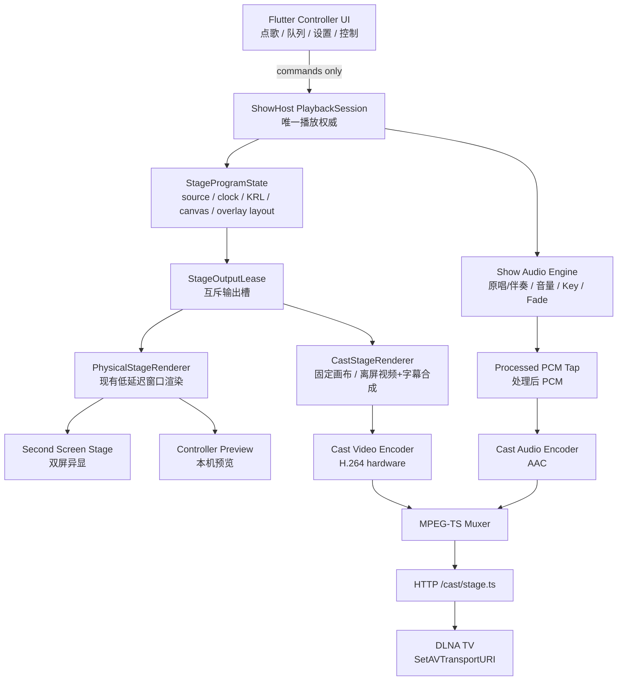
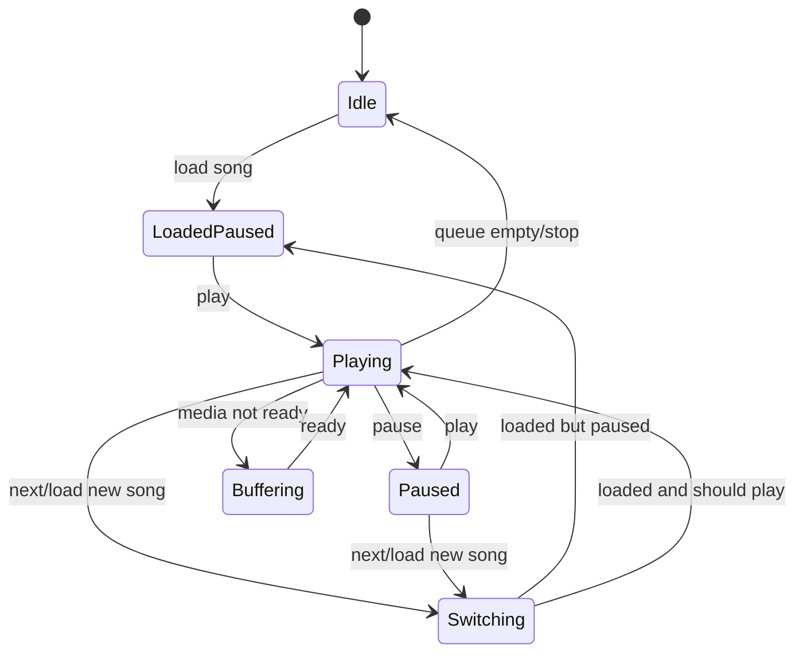

# Cast Stage Stream

Kirakara 的投屏输出是一条独立的 Stage Program Feed。它不是 Flutter
Controller UI 的镜像，也不是从预览窗口或第二屏窗口捕获画面。它更接近
内置的 KTV 专用 OBS：所有 source 都由 Kirakara Show / ShowHost 主动提供，
然后合成、编码、推流。

本文描述的是目标架构和阶段边界，不表示当前代码已经拥有完整
StageCompositor。当前 ShowHost 已经是播放状态权威；真正缺口是把现有
窗口叠层输出改造成主动合成输出。

DLNA / Cast 开启时，Controller Screen 不显示 Stage 预览。TS 投流和双屏异显
必须互斥：`physicalDisplay` 模式占用物理第二屏，`tsStream` 模式占用编码直播流。
二者抢同一个 Stage 输出槽，不能同时开启。

TS 投流要复用的是双屏异显背后的 Stage 节目模型、播放状态、画布和 overlay
语义，而不是录第二屏窗口。允许在更底层分成两套渲染流程：物理双屏保留
现有低延迟窗口渲染，TS 使用适合固定画布、离屏合成和编码的 Cast 渲染流程。
如果 Cast 通过第二屏 HWND / 字幕 HWND / 隐藏窗口取帧，就会把窗口层级、DPI、
字幕 viewport 和坐标系问题带进 TS 流。

## Architecture



## Playback Authority

ShowHost PlaybackSession 是唯一播放权威。DLNA / Cast 只是一种输出端，
不能维护第二套播放状态。

CastBackend 必须跟随 ShowHost 的状态：

- load / next：切换当前媒体源。
- play：开始推进时间轴。
- pause：停止推进时间轴，重复暂停帧或输出静止帧。
- seek：跳到 ShowHost 指定位置。
- buffering：输出等待帧或重复最后一帧，不能让音视频继续漂移。

ShowHost 当前已经集中持有播放状态、位置、暂停位置、音轨和视频主时钟等
状态。Cast 侧需要补的是可读取/可订阅的边界，例如 current media source
和 playback revision / callback，而不是另建一套播放器。

## State Machine



## Media Foundation Boundary

Media Foundation 可以用于 native 媒体管线：

- video decode：Source Reader / decoder MFT / D3D11 texture。
- video encode：H.264 encoder MFT / hardware encoder。
- audio encode：AAC encoder MFT。
- D3D11 device / DXGI texture flow.

Media Foundation 只负责解复用、解码和编码：decoder 直接产出 D3D11 texture，
encoder 直接消费 CastStageRenderer 的 texture。Stage 节目帧由 renderer 主动
合成。MF 不应该用于从窗口、预览框或已经渲染的 surface 取帧。
`TransferVideoFrame`、同步 `frame_at`、CPU BGRA readback 都属于已经验证过的
错误路线：它们会把已显示的东西再抠回来，容易阻塞，也会绕开真正的 Stage
输出架构。

解码端也不采用“每个 Stage 输出时刻向 MF 请求一帧”的 pull/frame-at 模型。
PlaybackSession 只同步 source、play/pause、timeline revision 和 seek 位置；MF
解码线程顺序产出一个小型 D3D11 texture 队列，CastStageRenderer 按权威 Stage
时钟消费队列中的现成纹理。编码端直接接收 CastStageRenderer 的合成纹理，MF
没有任何捕获 Stage、抓窗口或把合成结果读回 CPU 的接口。

## Current Show Pipeline

当前 Show 的实际显示管线仍然是窗口层叠：

```text
MF Media Engine -> stage HWND / swap chain
LyricRenderer   -> independent WS_EX_LAYERED subtitle window
```

视频和字幕目前靠窗口 Z-order 组合，不是同一张 texture。DLNA / Cast 如果
直接从这些窗口取画面，就会回到窗口捕获路线，也会继续受到 Flutter 弹窗、
窗口层级和桌面焦点影响。TS 投流可以复用 Stage 大屏渲染链路，但必须通过
`StageOutputLease.tsStream` 互斥抢占输出槽，不能和 `physicalDisplay`
双屏异显同时开启。

因此 StageCompositor 是投屏路线的核心阻塞项。它需要得到：

```text
video texture + transparent overlay texture -> composed stage texture
```

StageCompositor 必须维护固定节目画布，例如 1920x1080@30fps 或
1920x1080@60fps。源视频无论是 720p、1080p、4K、24fps、30fps 还是
60fps，都只是这个画布里的一个 source：按规则 letterbox / scale 后放入
画布，再叠加字幕；QR 和报幕后续按统一 Stage overlay 设计接入。
Encoder 只看到固定规格的 composed
stage texture，不直接感知源视频分辨率或帧率变化。

最终路线是用 MF media source / decoder MFT 或等价低级解码链路直接输出
D3D11 texture，再把 KRL 和后续统一 Stage overlay 渲染到透明 overlay
texture，最后合成。这里的 texture 是 decoder output，不是从 HWND、swap chain
或已经显示的画面抓回来的帧。

物理双屏保留现有窗口输出作为 `physicalDisplay` renderer，同时为 TS 建立
`tsStream` Cast renderer。二者必须互斥。Cast renderer 可以独立解码当前视频，
但它必须完全受 ShowHost PlaybackSession 控制，不能自己推进时间轴。共享的是
StageProgramState、画布、歌词和 overlay 语义，不要求两个 renderer 共用同一张
GPU texture。

## Cast Video

Cast video 必须来自 ShowHost 主动合成的 Stage 画面：

1. 读取当前歌曲背景视频。
2. 按 16:9 Stage 输出 letterbox / scale。
3. 叠加 KRL 歌词；QR、报幕和指示层等后续按统一 Stage overlay 接入。
4. 输出给 H.264 encoder。

启动 Cast video 前，App 必须确认没有物理第二屏或调试 StageWindow 正在占用
Stage 输出槽；如果已经占用，TS 开关禁用或要求用户先关闭该输出。

未播放时不能推进视频。暂停时不能推进视频。切歌时优先保持 HTTP / DLNA URL
稳定，可以重复最后一帧或输出 idle frame，等新源 ready 后继续输出 SPS/PPS
和 IDR。因为 Cast 输出是固定画布，切歌不应该改变 encoder 的输出分辨率、
帧率或基础流规格。真实电视兼容性不佳时，允许重建内部 encoder/session，
但外部 URL 应尽量稳定，并把这种行为记录为设备兼容策略，而不是默认架构。

## Cast Audio

Cast audio 必须来自 Show 音频处理链之后的 PCM。它必须已经应用：

- 原唱 / 伴奏切换。
- volume。
- key shift。
- key fade。

CastBackend 不能重新读取 vocal / inst 文件，也不能偷用背景视频自带音轨。
否则 DLNA 听到的声音会和房间实际播放不一致。

## Fallback Policy

ffmpeg 只能作为 native 编码链打通前的临时开发 fallback，用于验证 HTTP
MPEG-TS / DLNA 控制面。它不能成为最终运行时依赖，也不能独立读取当前视频
并自行推进时间轴。native H.264/AAC 接通后删除这条 fallback；最终发行包和
运行路径均不包含或调用 ffmpeg。

如果 fallback 存在，必须满足：

- 默认关闭或显式标记为 dev-only。
- 不冒充最终 NativeCastBackend。
- 不绕过 ShowHost PlaybackSession。
- 不绕过 Show 音频处理链。

当前 dev fallback：

- App 的投屏弹窗可以启动一个本机 MPEG-TS 测试流，方便用 VLC 验证。
- ffmpeg 只接收 ShowHost 已合成的 raw BGRA Stage frame，并编码为 H.264
  MPEG-TS。
- ffmpeg 的 MPEG-TS 输出写到 `pipe:1`，由 App 内置 HTTP server 转发到
  `/cast/stage.ts`。不要使用 ffmpeg 的 TCP listen 输出口；探测连接会吃掉
  唯一客户端并导致 VLC 卡在加载。
- ffmpeg 不读取当前歌曲视频/音频，不拥有播放时间轴。
- 测试 URL 默认是 `http://127.0.0.1:17392/cast/stage.ts`；如果端口被占用，
  App 会自动使用后续可用端口，并在投屏弹窗里显示实际 URL。

## DLNA Control Surface

DLNA 控制面不是单个 URL 推送按钮。第一版可以做最小可用子集，但仍然要把
这些模块当成真实边界：

- SSDP discovery：M-SEARCH / NOTIFY。
- device description：解析 device.xml 和 service URL。
- ConnectionManager：`GetProtocolInfo`。
- AVTransport：`SetAVTransportURI` / `Play` / `Pause` / `Seek`。
- RenderingControl：`SetVolume`。

可以评估 libupnp、Platinum 或自写最小子集。协议层不能反过来拥有播放状态；
它只把电视端控制映射回 ShowHost 命令。

## Phase Checklist

- Done: old local `DLNA-dev` branches were discarded and recreated from
  App `dev` and Show `main`.
- Done: this document freezes the cast architecture and forbidden paths.
- Done: ShowHost current media source / playback revision boundary.
- Done: Show fixed-canvas StageCompositor proof:
  1920x1080 canvas, source letterbox rect, transparent overlay texture, and
  native D3D/DXGI/D2D handles.
- Done: StageCompositor scales BGRA/D3D texture sources into the fixed canvas
  with D2D DrawBitmap, then allows lyrics to render into the same texture.
- Done: dev raw-BGRA cast stream is driven by ShowHost state; pause/stop do
  not advance the diagnostic frame.
- Removed: the transitional synchronous MF SourceReader BGRA `frame_at` path.
  It still pulled CPU frames and cannot be the production Cast video source.
- Done: MF video decode now runs sequentially on a worker into a bounded queue
  of decoder-output D3D11 textures. PlaybackSession synchronizes source,
  timeline revision, position and play/pause state; CastStageRenderer consumes
  queued textures without asking MF to capture a Stage frame. Real probes cover
  the bundled Nanatsukaze, Ikari and Agony MP4 files, including seek invalidation.
- Done: dev raw-BGRA fallback output is frame-rate throttled and preserves
  whole-frame socket ordering with a pending buffer.
- Done: dev raw-BGRA fallback socket/pacing state is isolated in a sink class
  so Host commands no longer own fallback transport details.
- Deferred: QR and report/ticker overlay are disabled until the second-screen
  Stage overlay design is unified.
- Done: processed PCM tap / ring buffer boundary in Show audio output path.
- Not done: NativeCastBackend.
- Not done: feed the composed D3D11 Stage texture to native H.264 encode.
- Not done: processed PCM to AAC encode.
- Done: native MPEG-TS muxer foundation for PAT/PMT/PES/PTS/PCR packets.
- Done: AAC ADTS packetizer foundation for wrapping encoded AAC frames.
- Done: MPEG-TS stream buffer foundation for HTTP readers and slow-reader
  reset handling.
- Done: NativeCastStream bridge for writing encoded H.264/AAC frames into a
  shared MPEG-TS reader stream.
- Done: native HTTP `/cast/stage.ts` server foundation backed by the shared
  MPEG-TS reader stream.
- Done: NativeCastBackend lifecycle shell owning the HTTP server and TS stream.
- Done: App dev MPEG-TS test button using ShowHost raw-BGRA output and ffmpeg
  as an explicit encoder/HTTP fallback for VLC testing.
- Done: dev fallback repaired to use ffmpeg `pipe:1` plus App HTTP relay, and
  raw-BGRA socket flushing is capped to avoid blocking the render loop.
- Not done: wire H.264/AAC encoder output into MPEG-TS.
- Not done: DLNA discovery and `SetAVTransportURI`.

## Verification Requirements

The cast implementation is not considered working until these are all true:

- Before pressing play, cast video does not run.
- During play, cast video follows ShowHost time.
- During pause, cast video freezes.
- After seek, cast video jumps to the same position as ShowHost.
- After next /切歌, cast switches to the new song without opening a second
  independent player.
- HTTP `/cast/stage.ts` survives pause, seek, and next.
- Cast audio reflects original / accompaniment, volume, key, and key fade.
