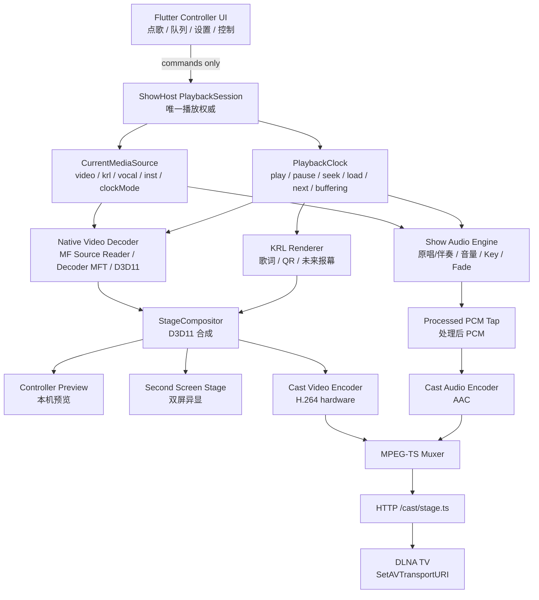
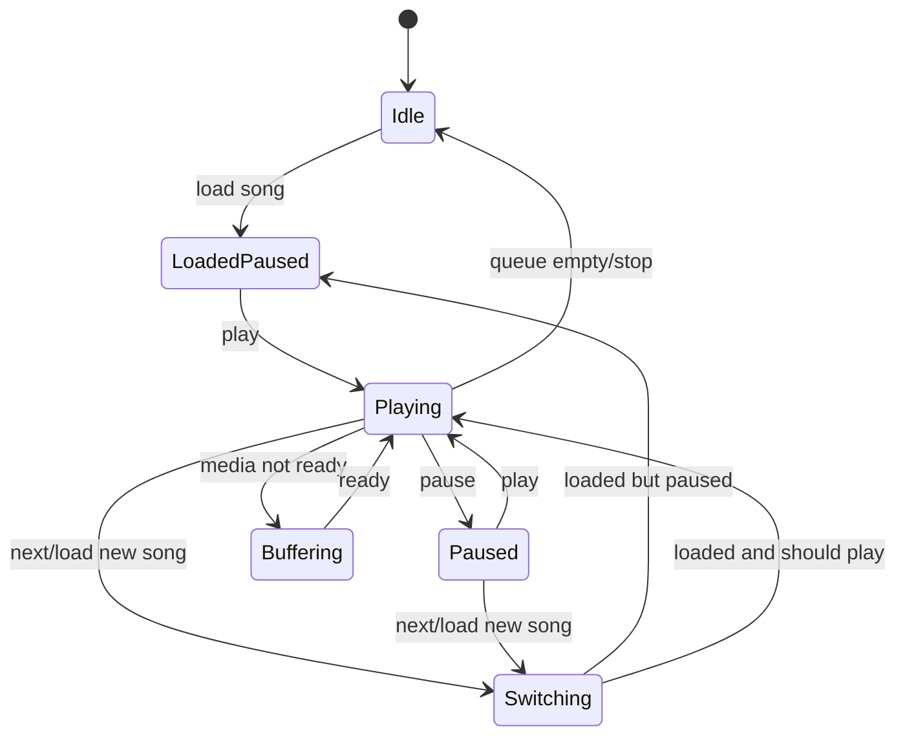

# Cast Stage Stream

Kirakara 的投屏输出是一条独立的 Stage Program Feed。它不是 Flutter
Controller UI 的镜像，也不是从预览窗口或第二屏窗口捕获画面。它更接近
内置的 KTV 专用 OBS：所有 source 都由 Kirakara Show / ShowHost 主动提供，
然后合成、编码、推流。

## Architecture

## Playback Authority

ShowHost PlaybackSession 是唯一播放权威。DLNA / Cast 只是一种输出端，
不能维护第二套播放状态。

CastBackend 必须跟随 ShowHost 的状态：

- load / next：切换当前媒体源。
- play：开始推进时间轴。
- pause：停止推进时间轴，重复暂停帧或输出静止帧。
- seek：跳到 ShowHost 指定位置。
- buffering：输出等待帧或重复最后一帧，不能让音视频继续漂移。

## State Machine

## Media Foundation Boundary

Media Foundation 可以用于 native 媒体管线：

- video decode：Source Reader / decoder MFT / D3D11 texture。
- video encode：H.264 encoder MFT / hardware encoder。
- audio encode：AAC encoder MFT。
- D3D11 device / DXGI texture flow.

Media Foundation 不应该用于从窗口或预览框取帧。`TransferVideoFrame` /
窗口 readback 属于已经验证过的错误路线：它会把已显示的东西再抠回来，
既容易阻塞，也会绕开真正的 Stage 输出架构。

## Cast Video

Cast video 必须来自 ShowHost 主动合成的 Stage 画面：

1. 读取当前歌曲背景视频。
2. 按 16:9 Stage 输出 letterbox / scale。
3. 叠加 KRL 歌词、QR、未来报幕和指示层。
4. 输出给 H.264 encoder。

未播放时不能推进视频。暂停时不能推进视频。切歌时 HTTP / DLNA 连接不能断开，
可以重复最后一帧或输出 idle frame，等新源 ready 后继续输出关键帧。

## Cast Audio

Cast audio 必须来自 Show 音频处理链之后的 PCM。它必须已经应用：

- 原唱 / 伴奏切换。
- volume。
- key shift。
- key fade。

CastBackend 不能重新读取 vocal / inst 文件，也不能偷用背景视频自带音轨。
否则 DLNA 听到的声音会和房间实际播放不一致。

## Fallback Policy

ffmpeg 可以作为开发 fallback，用于临时验证 HTTP MPEG-TS / DLNA 控制面。
它不能成为默认生产链路，也不能独立读取当前视频并自行推进时间轴。

如果 fallback 存在，必须满足：

- 默认关闭或显式标记为 dev-only。
- 不冒充最终 NativeCastBackend。
- 不绕过 ShowHost PlaybackSession。
- 不绕过 Show 音频处理链。

## Phase Checklist

- Done: old local `DLNA-dev` branches were discarded and recreated from
  App `dev` and Show `main`.
- Done: this document freezes the cast architecture and forbidden paths.
- Not done: ShowHost current media source boundary.
- Not done: transparent offscreen Stage overlay for cast.
- Not done: processed PCM tap / ring buffer.
- Not done: NativeCastBackend.
- Not done: native video decode / composition / H.264 encode.
- Not done: processed PCM to AAC encode.
- Not done: MPEG-TS muxer.
- Not done: DLNA discovery and `SetAVTransportURI`.

## Verification Requirements

The cast implementation is not considered working until these are all true:

- Before pressing play, cast video does not run.
- During play, cast video follows ShowHost time.
- During pause, cast video freezes.
- After seek, cast video jumps to the same position as ShowHost.
- After next /切歌, cast switches to the new song without opening a second
  independent player.
- HTTP `/cast/stage.ts` survives pause, seek, and next.
- Cast audio reflects original / accompaniment, volume, key, and key fade.
